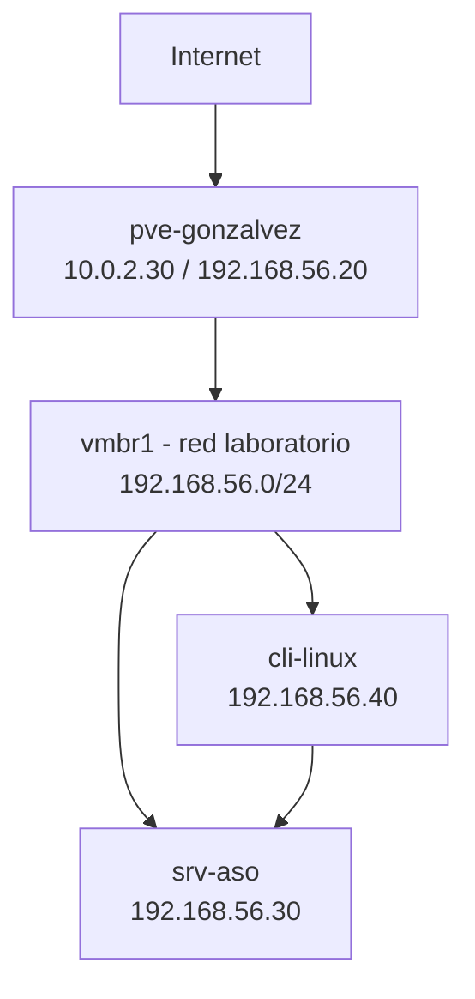
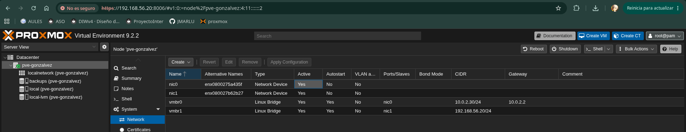
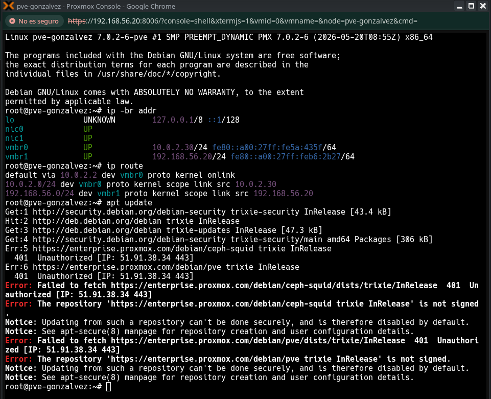

# 02-diagrama-red

## Objetivo

El objetivo de esta fase es diseñar la red de Proxmox antes de instalarlo junto a sus servicios.

## Diseño de Red

Nombre del nodo de Proxmox: pve-gonzalvez

Interfaz de gestión: 192.168.56.20/24 (vmbr1)

Bridge de Proxmox: vmbr0 es la salida a Internet (adaptador NAT) y vmbr1 el adaptador solo-anfitrión

Red o VLAN de laboratorio: 192.168.56.0/24

IPs de las VM/LXC: servidor: 192.168.56.30/24, cliente: 192.168.56.40/24

Gateway y DNS: cli-linux y srv-aso usan 192.168.56.20 (el nodo). El gateway del nodo es 10.0.2.2 (por defecto en VirtualBox) y el DNS es 8.8.8.8

Puertos necesarios: Proxmox 8006, Samba 445 y SSH 22

## Tabla

| Elemento | Nombre | IP | Función | Recursos |
|---|---|---|---|---|
| Nodo Proxmox | pve-gonzalvez | 10.0.2.30/24, 192.168.56.20/24 | Hipervisor | Máquina virtual |
| Servidor ASO | srv-aso | 192.168.56.30/24 | Servicio principal | Contenedor o máquina virtual |
| Cliente | cli-linux | 192.168.56.40/24 | Pruebas | Contenedor o máquina virtual |

## Diagrama de red

## Evidencias

Tras la instalación, ip -br addr muestra a vmbr0 con 10.0.2.30/24 y vmbr1 con 192.168.56.20/24, y ip route muestra la ruta por defecto vía 10.0.2.2, como en el diseño.

## Incidencias

Ninguna en el diseño.

## Conclusion

El diseño se implementó sin cambios en la instalación (03-instalacion-proxmox.md).

[Volver al indice](../README.md)
