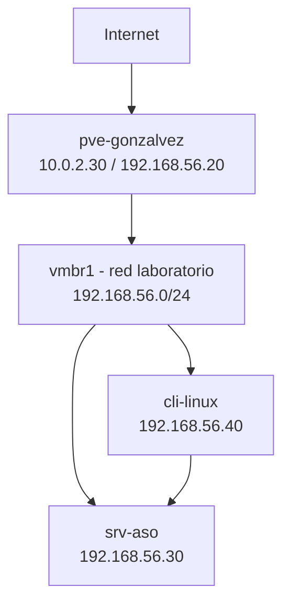

# 02-diagrama-red

## Objetivo

El objetivo de est fase es diseñar la red de proxmox antes de instalarlo junto a sus servicio.

## Diseño de Red

Nombre del nodo de proxmox: pve-gonzalvez

Interfaz de gestion: 192.168.56.20/24 (vmbr1)

Bridge de Proxmox: vmbr0 es la salida a Internet (Adaptador NAT) y vmbr1 adaptador solo-anfitrión

Red o VLAN de laboratorio: 192.168.56.0/24

IPs de las VMs/LXC: server: 192.168.56.30/24 cliente: 192.168.56.40/24

Gateway y DNS: cli-linux y srv-aso 192.168.56.20 (el nodo) y gateway del nodo: 10.0.2.2 (por defecto en VitualBox), DNS: 8.8.8.8

Puertos necesarios: Puerto de proxmox: 8006, Puerto samba: 445 Puero SSH: 22

## Tabla

| Elemento | Nombre | IP | Función | Recursos |
|---|---|---|---|---|
| Nodo Proxmox | pve-gonzalvez | 10.0.2.30/24,192.168.56.20/24 | Hipervisor | Maquina Virtual |
| Servidor ASO | srv-aso | 192.168.56.30/24 | Servicio principl | Contenedor o Maquina virtual |
| Cliente | cli-linux | 192.168.56.40/24 | Pruebas | Contenedor o Maquina Virtual |

## Diagrama de red

## Evidencias

## Incidencias

## Conclusion

[Volver al indice](../README.md)
