# 03-instalacion-proxmox

## Objetivo

Instalar Proxmox VE dentro de una máquina virtual de VirtualBox y configurar su red según el diseño de `02-diagrama-red.md`.

## Entorno

| Elemento | Valor |
|---|---|
| Anfitrión | Linux (PC del instituto), Intel Core i3-12100 (4 núcleos, 8 hilos), 15 GiB de RAM |
| Versión de VirtualBox | VirtualBox 7.2.20 |
| Nombre de la VM | pve-gonzalvez |
| Tipo / versión | Linux / Debian |
| CPU / RAM / disco | 3 CPU / 8 GB (8192 MB) / 80 GB VDI |
| ISO | proxmox-ve_9.2-1.iso |

## Procedimiento

### 1. Registrar la versión de VirtualBox

En **Ayuda → Acerca de VirtualBox**

### 2. Crear la VM Linux de 64 bits

**Máquina → Nueva**: nombre pve-gonzalvez, tipo Linux, versión Debian (64-bit), 3 CPU, 8192 MB de RAM y un disco VDI de 80 GB.

### 3. Reservar recursos para el anfitrión

La VM usa 8 GB de RAM y 3 CPU, y deja el resto de recursos para Windows.

### 4. Adaptadores de red

Red solo-anfitrión (**Archivo → Herramientas → Red → Redes solo-anfitrión**): IPv4 192.168.56.1, máscara 255.255.255.0, con DHCP desactivado.

| Adaptador | Conectado a | Interfaz en Proxmox | Uso |
|---|---|---|---|
| Adaptador 1 | NAT | nic0 | Salida a Internet (vmbr0) |
| Adaptador 2 | Adaptador solo-anfitrión | nic1 | Red de laboratorio y gestión (vmbr1) |

En el Adaptador 2, *Modo promiscuo = Permitir todo*.

### 5. Virtualización anidada

Con la VM apagada se activó la virtualización anidada en la configuracion del procesador

### 6. Instalar Proxmox en el VDI

Se montó la ISO y se arrancó con *Install Proxmox VE (Graphical)*. El disco de destino es el VDI de 80 GB.

| Campo | Valor |
|---|---|
| País / zona horaria | España / Europe/Madrid |
| Interfaz de gestión | nic0 (NAT) |
| Hostname (FQDN) | pve-gonzalvez.lab.local |
| IP / CIDR | 10.0.2.30/24 |
| Gateway | 10.0.2.2 |
| DNS | 8.8.8.8 |

Al terminar se quito la ISO y se reinició.

### 7. Configurar IP de gestión, hostname y DNS, y abrir el panel

Se editó /etc/network/interfaces para añadir vmbr1 (red de laboratorio y gestión) junto a vmbr0 (NAT):

```
auto lo
iface lo inet loopback

iface nic0 inet manual

auto vmbr0
iface vmbr0 inet static
        address 10.0.2.30/24
        gateway 10.0.2.2
        bridge-ports nic0
        bridge-stp off
        bridge-fd 0
        
iface nic1 inet manual

auto vmbr1
iface vmbr1 inet static
        address 192.168.56.20/24
        bridge-ports nic1
        bridge-stp off
        bridge-fd 0

source /etc/network/interfaces.d/*
```

Se reinició y se comprobó con ip -br addr, ip route y hostname -i.

El panel se abre desde el navegador del anfitrión en https://192.168.56.20:8006, con usuario root y dominio **Linux PAM standard authentication**.

## Evidencias

### Panel de Proxmox

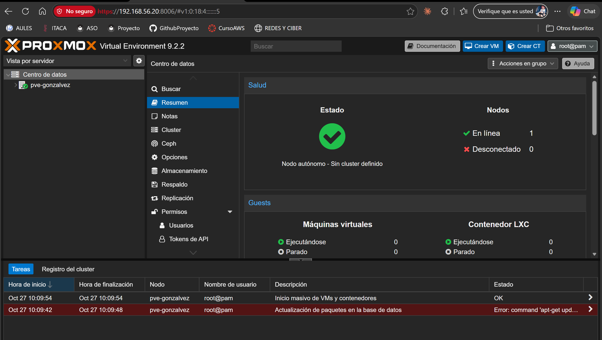

### Red

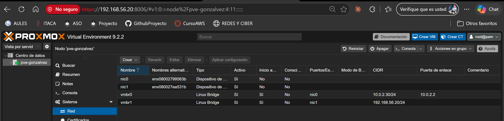

### Almacenamiento

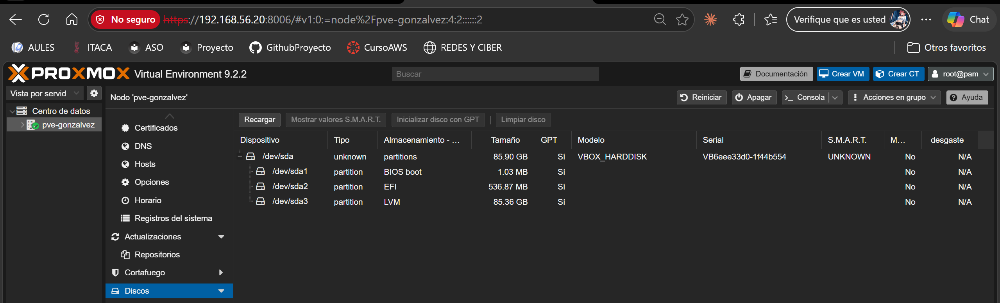

### Salida de comandos

Salida de hostnamectl, ip -br addr, pveversion y df -h:

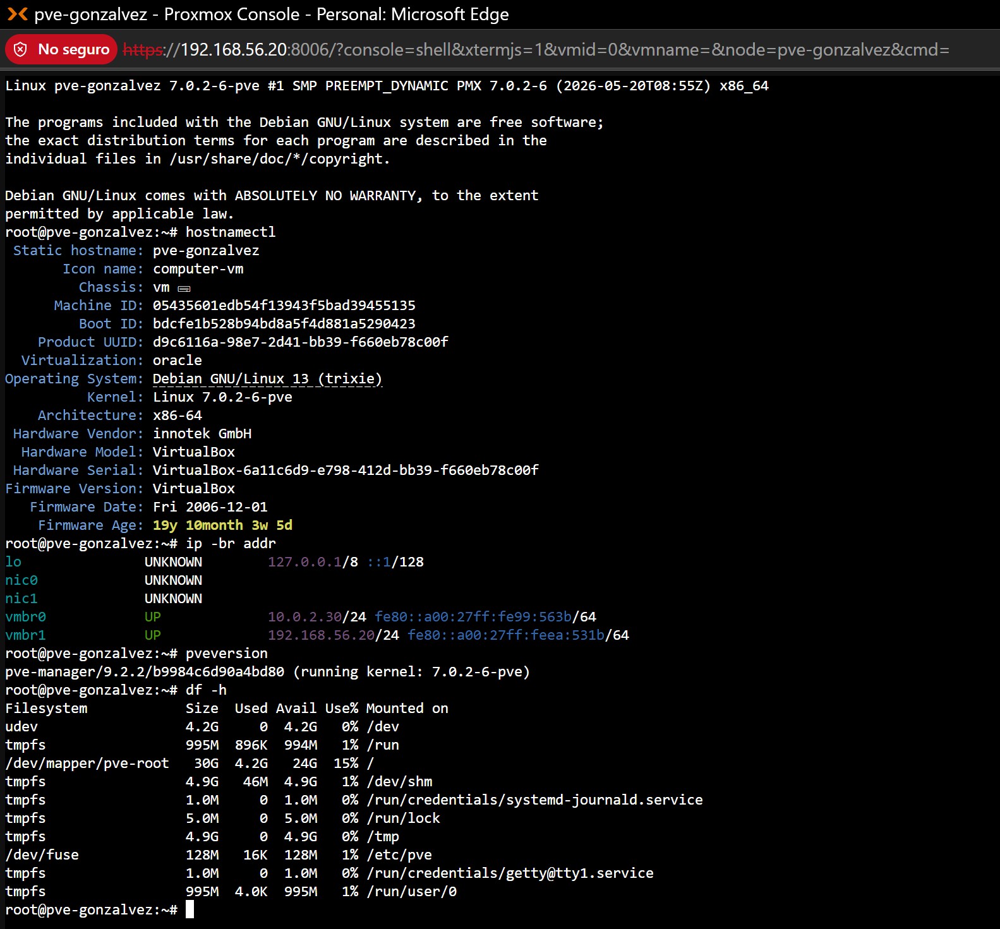

### KVM

Comprobacion de si KVM está disponible

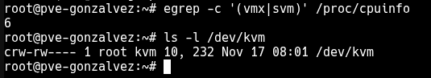


## Conclusión

Se instaló Proxmox VE en una VM de VirtualBox con 3 CPU, 8 GB de RAM y 80 GB de disco. La red de gestión está en vmbr1 (192.168.56.20/24) y la salida a Internet en vmbr0 (10.0.2.30/24), según el diseño de 02-diagrama-red.md. El panel es accesible desde el navegador del anfitrión en https://192.168.56.20:8006. El nesting no pudo usarse por la seguridad basada en virtualización de Windows, lo que queda documentado en Incidencias. La virtualización anidada está disponible: se comprobó con "/dev/kvm".

## Fase 4. Configuración base del nodo

### 1. Almacenamiento

En la conexion del nodo entramos en Datacenter > Storage y revisamos el almacenamiento:


| Almacenamiento | Para qué sirve | Contenido que admite | Espacio libre |
|---|---|---|---|
| local | Guardar ISO, plantillas de contenedor y copias | ISO, plantillas de contenedor, copias de seguridad e importación | 23,6 GiB libres |
| local-lvm | Guardar los discos de las máquinas y contenedores | Imágenes de disco y discos de contenedor | 29,9 GiB libres |
| backups | Guardar las copias de la fase 9 | Copias de seguridad | 23,6 GiB libres |

```
mkdir -p /srv/backups
pvesm add dir backups --path /srv/backups --content backup
pvesm status
df -h
```


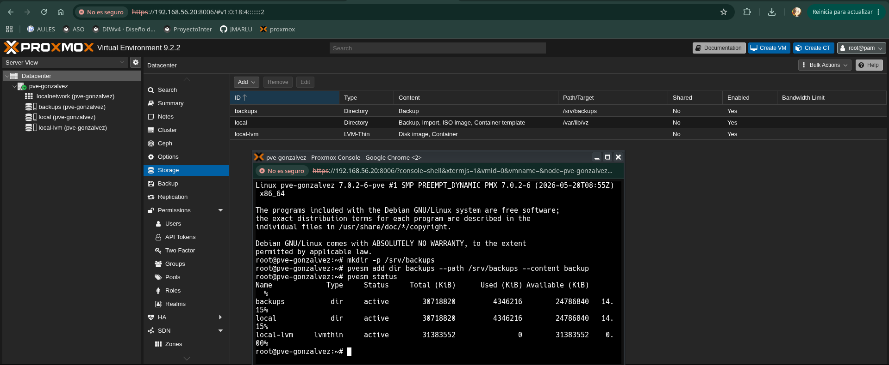

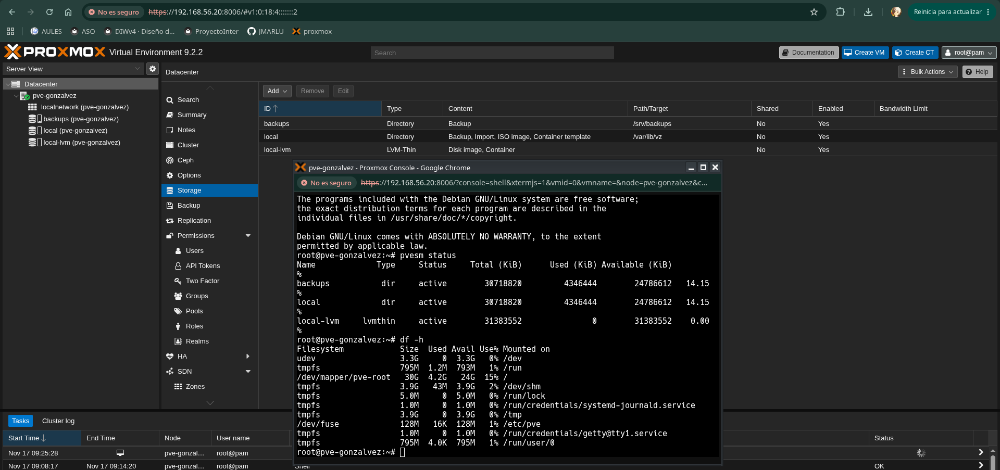


Comprobamos que el espacio de cada almacenamiento coincide con lo que muestra Datacenter → Storage, y que backups aparece como active en pvesm status. local-lvm solo admite discos de máquinas y contenedores, no adnite ISO ni copias, por eso las copias van a backups.

Disco anfitrión → VDI de Proxmox → grupo pve → discos de srv-aso y cli-linux → sistema de archivos de cada invitado. Cada capa usa espacio de la anterior.

| Contenido | Destino | Motivo |
|---|---|---|
| ISO de instalación | local | Admite ISO y tiene espacio libre |
| Disco de srv-aso y cli-linux | local-lvm | Admite discos de VM y contenedores |
| Copias de seguridad | backups | Contenido de backup habilitado y disponible en pvesm status |

Espacio libre en el disco del anfitrión: 116GB libres. El VDI es dinámico y puede crecer hasta 80 GB, así que el disco del anfitrión puede alojar ese crecimiento, aunque Proxmox vea ese espacio como suyo.

Riesgo: el laboratorio y las copias están en el mismo disco físico. Si ese disco falla, se pierden a la vez el VDI, los discos de las máquinas y las copias.

Pendiente: la copia real, que se hará en la fase 9.

### 2. Interfaces y red

En Nodo → System → Network identificamos las interfaces, los bridges y la dirección de gestión:

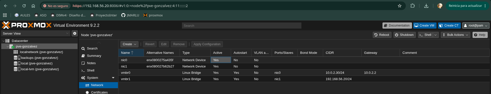

```
ip -br addr
ip route
apt update
```

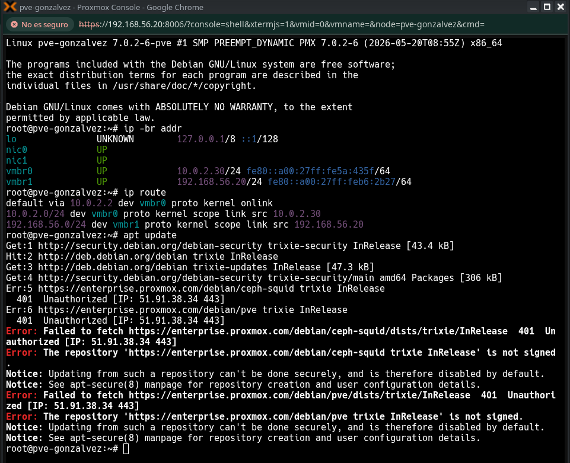

| Bridge | Interfaz | Adaptador de VirtualBox | IP | Gateway |
|---|---|---|---|---|
| vmbr0 | nic0 | Adaptador 1 (NAT) | 10.0.2.30/24 | 10.0.2.2 |
| vmbr1 | nic1 | Adaptador 2 (solo-anfitrión) | 192.168.56.20/24 | |

Comprobamos que la IP, la máscara y el gateway coinciden con 02-diagrama-red.md. La dirección de gestión es 192.168.56.20 (vmbr1), y desde el anfitrión se abre el panel en https://192.168.56.20:8006. El nodo resuelve nombres y accede a los repositorios de Debian, porque apt update descarga sus listas. Los repositorios enterprise de Proxmox devuelven error 401 porque requieren suscripcion de pago. 

### 3. Accesos de administración

```
pveum user list
pveum acl list
pve-firewall status
```

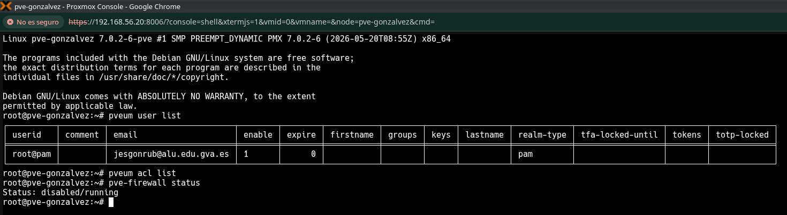

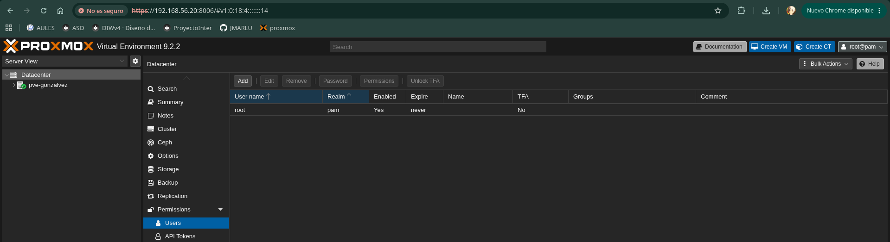

La cuenta de administración es root@pam (Linux PAM), que se usa en el panel (https://192.168.56.20:8006) y en la consola del nodo. Tiene permisos totales sobre el nodo, y pveum acl list no muestra reglas adicionales. No se han creado otros usuarios ni roles. Las contraseñas no aparecen en capturas ni en el repositorio.

El firewall de Proxmox no es obligatorio en esta práctica y se deja desactivado, según pve-firewall status. Aislamiento del laboratorio: la red 192.168.56.0/24 es solo-anfitrión, el panel solo se abre desde el anfitrión y de momento, el nodo no reenvía el tráfico de vmbr1 hacia Internet. 

Pendiente: si se acuerda activar el firewall, preparar antes las reglas y el acceso por la consola de VirtualBox.

### 4. Reparto de recursos

Presupuesto de la sesión 01 (equipo físico): 2 GB y 2 vCPU para srv-aso y para cli-linux, con 1,6 GB de RAM de margen. Se actualiza con lo observado tras instalar Proxmox en una VM de 3 vCPU, 8 GB de RAM y VDI de 80 GB, sobre un anfitrión con 8 hilos y 15 GiB de RAM.

```
nproc
free -h
```

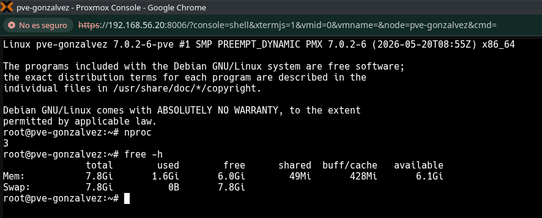

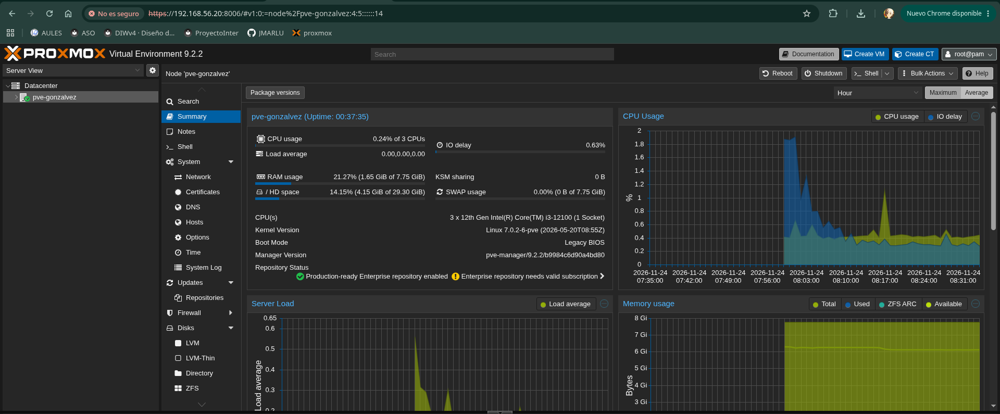

| Elemento | CPU/vCPU | RAM | Disco o almacenamiento | Motivo del reparto |
|---|---|---|---|---|
| Nodo Proxmox | 3 vCPU (VM) | 8 GB en total (7,8 GiB visibles); el nodo usa 1,6 GiB y se reservan 2 GB | VDI de 80 GB | Poder administrar el nodo con las máquinas en marcha |
| srv-aso | 2 | 2 GB | 10 GB | Servicio principal con carga ligera |
| cli-linux | 2 | 2 GB | 10 GB | Cliente de pruebas, mismo tamaño para clonar de una plantilla |
| Plantillas, ISO, copias y margen | n/a | 2,2 GiB libres (7,8 − 1,6 − 4) | 9,9 GiB libres en local-lvm (29,9 − 20) y 23,6 GiB en local | La plantilla va en local-lvm, las ISO y copias, en local y backups |

Medido con free -h: el nodo usa 1,6 GiB de 7,8 GiB con las máquinas apagadas. Al encender srv-aso y cli-linux (2 GB cada uno), el uso previsto es de unos 5,6 GiB, que deja 2,2 GiB libres.

El disco por máquina baja de los 80 y 50 GiB previstos en el equipo físico a 10 GB cada una, porque local-lvm solo tiene 29,9 GiB y el aprovisionamiento ligero no debe llenarse.

Reserva para el anfitrión: 15 − 8 = 7 GiB de RAM y 5 de los 8 hilos. Los dos invitados suman 4 vCPU sobre las 3 de la VM, aceptable porque no estarán al máximo a la vez.

Comprobado: el reparto permite administrar el nodo con servidor y cliente encendidos.

Pendiente: ajustar el reparto si el rendimiento no es suficiente (fase 10).


[Volver al índice](../README.md)
